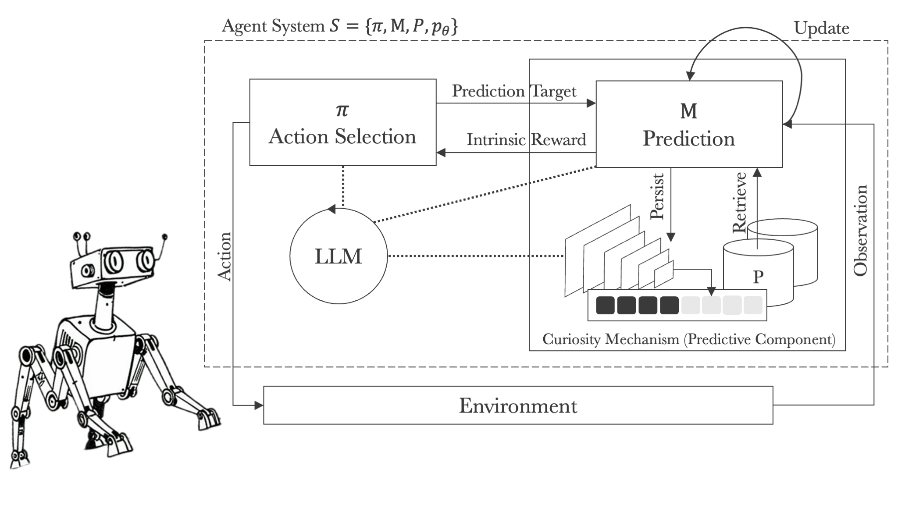
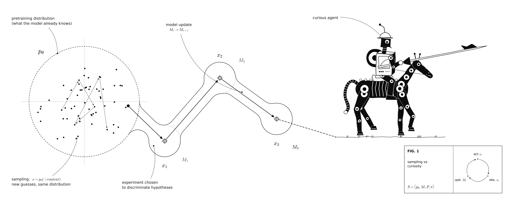

*Agents explore. But they don't learn from exploring.*

---

## Two agents in the lab

We currently use agents in applications where we need them to explore well, and we increasingly describe that as curiosity. Let's start with an example.

Imagine you ask an LLM agent to design a battery electrolyte for electric cars that have to work through a Minnesota winter. It needs to keep working well at -30°C without breaking down when the battery heats up during fast charging. The agent can access a simulator and can synthesize and test candidates.

We could have two agents.

The first agent does what most agents do today. It brainstorms a diverse set of candidate formulations, maybe by turning up the temperature or sampling best-of-N. It tests them in whatever order it happens to produce them. When a candidate freezes up in the cold or degrades under heat, the agent appends the failure to its context and proposes something else. With enough attempts, it might land on something that works.

The second agent works differently. It keeps a few competing hypotheses about why candidates fail, maybe the solvent mixture is too viscous at low temperature, or maybe the salt concentration is what drives breakdown under heat. Before testing anything, it asks: under each hypothesis, what would this candidate do? Then it tests the candidate whose result would best tell those explanations apart, even if that candidate isn't the one most likely to succeed. It updates its hypotheses based on the result, and carries that updated understanding into choosing the next candidate. Over time, it isn't just searching for a working electrolyte; it's building a model of what makes one work in these conditions.

Both agents take many actions. Both interact with a real environment. Both might use memory. Both might even end up with a working electrolyte. From the outside, both look like they're "exploring."

The difference is what each one is left with after every experiment. The first agent's understanding of electrolytes at the end is the same as at the start, it has a longer list of failures, but its next guess is drawn from the same distribution as its first. The second agent's model gets better with each result. Its predictions about which candidates will work become sharper, so its proposals become better, and the experiments it runs become more informative. Learning compounds and a better model leads to better experiments, which lead to a better model.

That's why the second agent should reach good designs with fewer experiments, and why it ends up with something more valuable than a single working electrolyte: an improved model of what makes electrolytes work in the cold and under heat.

That's the argument of our paper in one example. Let's look into the details and why the distinction matters, where it comes from and what it would take to build agents that actually have it.

---

## Exploration vs. adaptation

We increasingly need agents with better exploratory skills, and it's easy to mistake an LLM sampling diverse outputs for curiosity. The vocabulary comes from decades of reinforcement learning research, where it meant something specific.

The core point is simple. At inference time, an LLM is a fixed function from context to next-token distribution, and its weights don't change during an episode. Temperature, best-of-N, tree search, RAG, and tool use are all useful, but they only change how that function is sampled or what it's conditioned on. None of them changes the agent's model of the environment.

We call this the difference between **interaction-level exploration** (varying actions and contexts while the predictive function stays fixed) and **model-level adaptation** (updating a model of the environment from what the agent observes). Current agents do plenty of the first. Curiosity requires the second. In simple words, current LLM agents don't explore curiously. They explore stochastically.

---

## An agent is more than its LLM

This doesn't mean an LLM agent can never be curious. It means we should stop looking for curiosity inside the sampling procedure and look at the whole system instead.

In the paper, we treat an agent as a system with four parts:

**S = ⟨p<sub>θ</sub>, M, P, π⟩**

- **p<sub>θ</sub>** is the LLM itself.
- **M** is a predictive model of how the environment responds to the agent's actions.
- **P** is persistent state that survives beyond the context window.
- **π** is the policy that picks actions.



---

## A short history of teaching machines to be curious

Computational curiosity tries to give machines the drive to explore and understand that humans have. An important line of this research goes back to the 1990s, when Schmidhuber proposed agents with a learnable world model and [an intrinsic reward for surprise](https://sferics.idsia.ch/pub/juergen/curiositysab.pdf), where the agent is rewarded when its predictions are wrong.

However, this ran into the [noisy TV problem](https://arxiv.org/abs/1808.04355). Put a screen of random noise in the environment, and a surprise-seeking agent will stare at it forever, since white noise can never be predicted. Follow-up work fixed it by rewarding [learning progress](https://sferics.idsia.ch/pub/juergen/curioussingapore.pdf) instead of error. The key is to reward how quickly it is becoming less wrong. Curiosity shifted from "what surprises the agent" to "what the agent is coming to understand."

Later work formalized this as [information gain](https://people.idsia.ch/~juergen/icann95new.pdf) (1995), [Bayesian surprise](https://proceedings.neurips.cc/paper_files/paper/2005/file/0172d289da48c48de8c5ebf3de9f7ee1-Paper.pdf) (2005), and [compression progress](https://people.idsia.ch/~juergen/ieeecreative.pdf) (2010), where the agent is rewarded for finding regularities that let it describe its experience more compactly. [PowerPlay](https://doi.org/10.3389/fpsyg.2013.00313) (2013) extended it to agents that invent their own problems.

Looking at these works, we see the same four ingredients:

1. A learnable model that predicts the environment.
2. That model updating from the agent's own interaction.
3. An intrinsic reward based on how much the model improves.
4. Actions chosen to earn that reward.

And a fifth, for when the environment doesn't tell you what to predict: the agent invents its own targets.

---

## How is this different in LLMs?

This tradition was built for robots and game-playing agents with pixel observations, sensor readings, a small set of discrete actions, and agents that start out knowing nothing. LLM agents differ on several points.

- Their environments are conceptual, like codebases, literatures, scientific domains. These don't fit neatly into a state space.
- Their action space is open-ended. They write in natural language, which is then translated into tool calls or queries.
- They come with huge priors. Pretraining is doing real work before the episode starts.
- In open-ended tasks, nobody tells them what to predict.

The priors point deserves special attention. If an agent gets better at a task during an episode, was that learning, or was the answer already in the weights? A curious agent has to be able to tell the difference between what it already knew and what it just found out. Otherwise we'll keep giving credit for curiosity to pretraining.



---

## The 5 commitments for Curious Agents

Adapting this RL tradition to LLM-based agents, we propose five commitments: a checklist for deciding whether a system is curious.

**[C1] Predict the environment.** The agent keeps a model of how the environment responds to its actions. The target is the world, not the agent's own outputs. A model can be uncertain about what it's going to say for reasons that have nothing to do with the world.

**[C2] Update from interaction.** That model improves during the episode, and the improvement comes from what the agent observes, not from pretraining or retrieval from a fixed corpus.

**[C3] Act to learn.** The agent picks actions because it expects them to improve its model. This closes the loop. Without it, the agent might learn, but the learning doesn't steer what it does next.

**[C4] Retain the improvement.** What the agent learned stays available after it falls out of the context window.

**[C5] Choose what to investigate.** In open-ended settings, the agent decides what's worth modeling: its own questions, benchmarks, or fitness functions.

C1–C4 define task-driven curiosity: given a domain, the agent investigates it well. That corresponds to the side of science focused on finding answers to given questions. C5 focuses on the other side of science, coming up with good questions, and it marks the frontier of open-ended curiosity. An agent that designs smart experiments inside a domain a human chose is still curious under C1–C4. It just isn't open-ended.

---

## Where are we today?

Many current methods already do valuable work on exploration, such as encouraging diverse outputs, keeping memories of past attempts, or running long searches over a problem. The commitments help show which parts of curiosity each approach covers and which are still open. Some recent systems already close the full loop. [WorldLLM](https://arxiv.org/abs/2506.06725) keeps natural-language hypotheses about its environment and updates them as it experiments; [SENSEI](https://proceedings.mlr.press/v267/sancaktar25a.html) learns a world model and explores where it is most uncertain; and [AutoDiscovery](https://arxiv.org/abs/2507.00310) uses how surprising an experiment's result is to decide what to test next. In each of them, what the agent does next depends on what it expects to learn. Choosing its own questions (C5) is still open for all of them.

A natural question is whether in-context learning already does this, since predictions improve as observations pile up in the context. It covers part of it (C1 and C2), but on its own it doesn't choose actions in order to learn (C3), and what it learns is lost once the context fills up (C4). That makes it a promising starting point rather than the full answer.

---

## Open problems

The commitments are a list of things we don't know how to do well yet:

- **Measuring learning inside an episode.** Benchmarks like DiscoveryWorld and MLAgentBench score outcomes, not whether the agent's predictions improved along the way. The hard part is attribution: separating learning from priors, retrieval, and pattern-matching.
- **Balancing curiosity with the actual job.** Real agents have users and objectives. How should an intrinsic learning signal be weighed against task reward when the action space is open-ended language?
- **Choosing what to predict.** Even in WorldLLM, a human specifies the hypothesis space. Deciding what's worth modeling is open, and it's the core of C5.
- **Curiosity across agents.** Agents that share what they learn could let one agent's progress guide what the others investigate.

---

## Why does it matter?

You could ask if this is just an argument about terminology. But as AI research gets automated, I believe it is important to create good definitions that can bring attention to certain research problems and move the field forward. Agents are being asked to do more open-ended work, where the hard part isn't completing a task but figuring out what's worth knowing. That's exactly where the gap between sampling and curiosity matters most. If we call every diverse-sampling method "curious," we lose the ability to even say what's missing.

Our agents are already good at answering questions. The next step is agents that learn from their own actions, and eventually, agents that ask good questions of their own, while keeping that curiosity aligned with what humans care about.

---

If you found it interesting, this was a Spotlight Paper at the NeurIPS 2026 Position Paper Track. You can read it here: [arxiv.org/abs/2611.10501](https://arxiv.org/abs/2611.10501)

**Cite:**

```bibtex
@article{amayuelas2026sampling,
  title={Sampling Is Not Curiosity: Why LLM Agents Should Investigate},
  author={Amayuelas, Alfonso and Pi{\k{e}}kos, Piotr and Wang, Xin Eric and Wang, William Yang and Schmidhuber, J{\"u}rgen and Pentland, Alex},
  journal={arXiv preprint arXiv:2611.10501},
  year={2026}
}
```
